# Voice Assistant

**A self-hosted, hands-free voice assistant: say "Assistant" to a tiny ESP32-S3 device and a small Kubernetes cluster on consumer GPUs answers out loud.**

I built AI Companion to turn an M5StickS3 into a voice interface for locally hosted speech and language models. The Stick listens for its wake word on-device, then sends your speech over **Bluetooth Low Energy (BLE)** to an Android relay and on to a **k3s** backend running speech-to-text, LLM inference, tools, and text-to-speech. A custom controller handles GPU availability and inference failover between my laptop and home server.

<table>
  <tr>
    <th>Assistant</th>
    <th>Clock</th>
    <th>Pomodoro</th>
  </tr>
  <tr>
    <td></td>
    <td>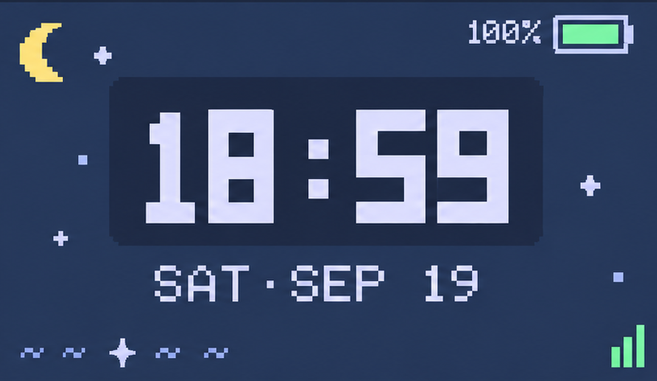</td>
    <td>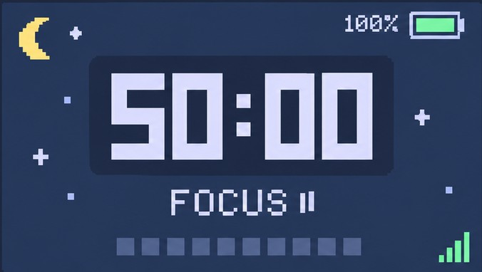</td>
  </tr>
</table>

## Features

- **Wake word:** say "Assistant" and the Stick starts listening, using a microWakeWord model trained locally and running on the device (2.8 ms per 30 ms of audio).
- **Hands-free conversation:** an on-device endpointer detects when you start and stop speaking and sends only the speech.
- **Local speech and language:** Moonshine STT on CPU, Qwen on llama.cpp, and Kokoro TTS on the GTX 1650 whenever the LLM doesn't need that card (KittenTTS on CPU when it does). Replies are spoken a sentence at a time, so audio starts before the whole reply is ready.
- **Agent tools over MCP:** web search, notes, reminders, voice switching ("switch to Kokoro Bella", while TTS runs on the CPU), ESP32 device volume and brightness, and `ask_claude` for questions the local model can't answer well.
- **Speaks first:** reminders arrive unprompted, with no button press.
- **Speaker verification:** ECAPA-TDNN matching against an enrolled voiceprint.
- **Embedded interface:** animated pixel-art face, clock, and pomodoro timer on a 240×135 display.
- **Resilience:** BLE reconnection, OTA firmware updates over BLE with automatic rollback, and GPU inference failover.
- **Observability:** OpenTelemetry traces, Prometheus metrics, Grafana dashboards, Tempo, a custom NVML GPU exporter, and a terminal dashboard (`tools/obs_tui.py`).
- **Validation:** CI runs the test suite, validates the Kubernetes manifests, and builds the firmware, the Android app, and the service images.

Still in progress: raise-to-talk, haptic feedback, voice isolation, and a long-duration BLE soak test.

## Architecture

The Stick hears the wake word and streams your speech over Bluetooth to a phone relay, which forwards each turn to a gateway on the always-on home server; the gateway runs speech-to-text, the LLM agent and text-to-speech as separate Kubernetes services and streams the spoken reply back the same way.

<details>
<summary><b>Architecture diagram</b></summary>

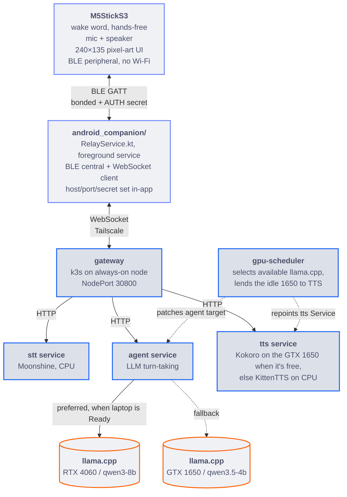

</details>

### How the relay works:
The Android relay translates these messages 1:1 to and from BLE frames.

<details>
<summary><b>Message sequence for one turn</b></summary>

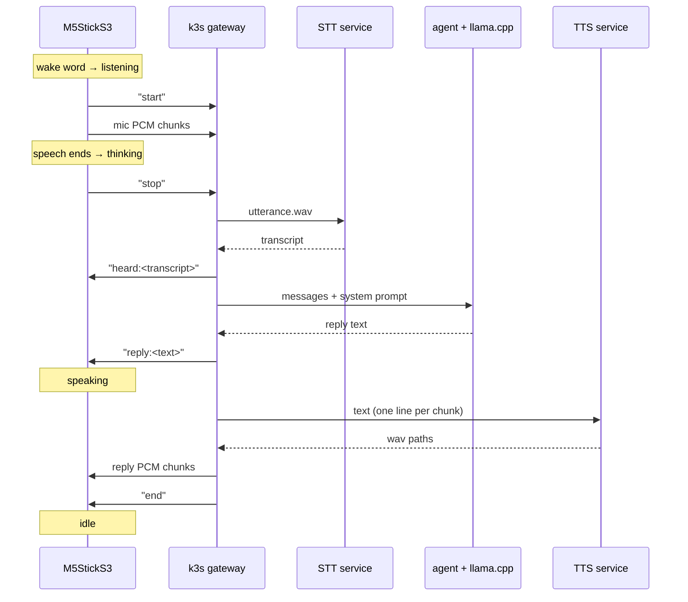

</details>

<details>
<summary><b>How a turn runs in each GPU mode</b></summary>

The loop is the same in both modes; what changes is which llama.cpp server the `agent` calls and where TTS runs: on the GTX 1650 while the laptop serves the LLM, on the CPU while the 1650 runs the standby LLM.

**Laptop offline: GTX 1650 only (fallback).**

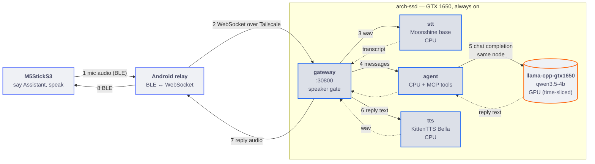

**Laptop Ready: RTX 4060 online (preferred).**

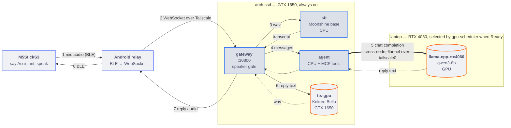

</details>

## Custom Kubernetes controller

`gpu-scheduler` helps the live service figure out which backend to call: it prefers the laptop's **RTX 4060** for inference and falls back to the home server's **GTX 1650** when the laptop goes away. While the 1650 isn't needed for the LLM, it lends the card to TTS.

<details>
<summary><b>How the controller decides</b></summary>

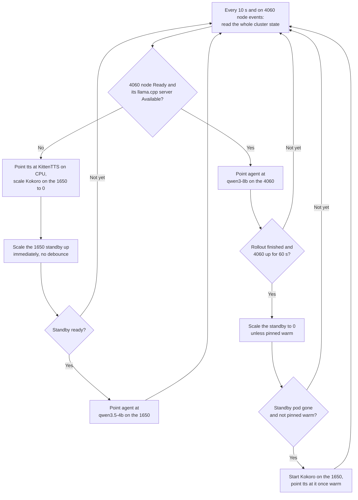

</details>

**Tradeoff:** this is *availability-based failover*, not per-request load balancing. Measured over five runs each (2026-11-10, [`benchmarks/runs/gpu_allocation/`](benchmarks/runs/gpu_allocation/)), the first good reply after the 4060's server goes down comes 4.5 to 5 minutes later from a cold standby, or 30 s with `tools/standby.sh warm` keeping it loaded. A real laptop loss adds the time k3s takes to notice the node is gone. Coming back to the 4060 takes 17 to 29 s with no failed requests. A warm standby can't share the 1650 with Kokoro: together they filled all 3.64 GiB the card offers and Kokoro ran out of memory, so pinning the standby moves TTS to the CPU.

<details>
<summary><b>Failover details</b></summary>

Switching modes is automatic. `gpu-scheduler` re-evaluates every 10 seconds and
on every 4060 node event, from the whole picture rather than one transition: the
4060 counts as up only when its node is `Ready` **and** `llama-cpp-rtx4060` is
serving. Then:

- **4060 up**: it patches `agent` to `LLM_HOST=http://llama-cpp-rtx4060:8080/v1`,
  `LLM_MODEL=qwen3-8b`, and once that rollout has finished **and the 4060 has been
  up for 60 seconds** it scales `llama-cpp-gtx1650` to zero, freeing about 1 GiB
  of RAM and 3.4 GiB of VRAM on the home server. The 60 s debounce keeps a
  laptop that sleeps and wakes from making the 1650 reload its model every time.
- **4060 lost** (`NotReady`, deleted, or its server down): it scales the 1650
  standby back up first, and only points `agent` at
  `http://llama-cpp-gtx1650:8080/v1`, `qwen3.5-4b` once the standby reports
  ready, so `agent` never targets a server that isn't there. From zero the
  standby takes 2 to 3 minutes to be ready (mostly starting its container from
  the home server's hard disk), and the first request to a fresh server takes
  about 110 s more while it reads the system prompt and tool definitions; turns
  during that window fail and should be retried.
- **Pinned warm**: `tools/standby.sh warm` keeps the standby running for an
  instant failover at the cost of its RAM/VRAM; `auto` hands it back.
- **TTS on the idle 1650**: once the standby's pod has left the card (and it
  isn't pinned), it starts `tts-gpu` (Kokoro on CUDA) and, once it has warmed
  up, points the `tts` Service at it. On any loss of the 4060 it points the
  Service back at KittenTTS on CPU, which always runs, and scales `tts-gpu` to
  zero in the same pass that starts the standby, so the LLM gets the card. If
  Kokoro itself restarts or crashes, TTS goes back to the CPU until it's ready.
  Repointing a Service restarts nothing. Voice switching only works on the CPU
  pod; `aicompanion/gpu-tts=off` on `tts-gpu` keeps TTS on the CPU.

Each patch to `agent` rolls its pod, so a turn in flight during a switch can fail.
Nothing the Stick or phone talks to moves in either case.

</details>

## Observability

Every stage of a voice turn is measured, and the monitoring stack stays up when the laptop goes away because it runs on the always-on node.

- **Prometheus** scrapes the gateway, STT, agent, TTS, kube-state-metrics, and the GPU exporter every 15 seconds, including per-stage turn latency.
- **Grafana** provisions a service-performance dashboard: target health, request and error rate, HTTP and gateway latency, pod readiness and restarts, GPU and VRAM use, and traces.
- **OpenTelemetry and Tempo** trace a turn across services, breaking it into STT, LLM, and TTS.
- **A custom NVML GPU exporter** (`services/gpu_exporter`) replaced NVIDIA's DCGM Exporter, going from about 405 MiB to 37 MiB while adding clocks, throttle reasons, energy, XID errors, and VRAM per pod.
- **A terminal dashboard** (`tools/obs_tui.py`, standard library only) shows host memory, GPUs, pods, latency, and recent turns without a browser.


<!-- Add assets/charts/distributed-trace.png, then uncomment:

-->

## Benchmarks

I compared STT, TTS, and language models on speed and memory to choose what's practical for my hardware. Find the benchmark runs in: [`benchmarks/runs/`](benchmarks/runs/).

### Speech-to-text

<picture>
  <source media="(prefers-color-scheme: dark)" srcset="assets/charts/stt-cpu-speed-vs-ram-dark.svg">
  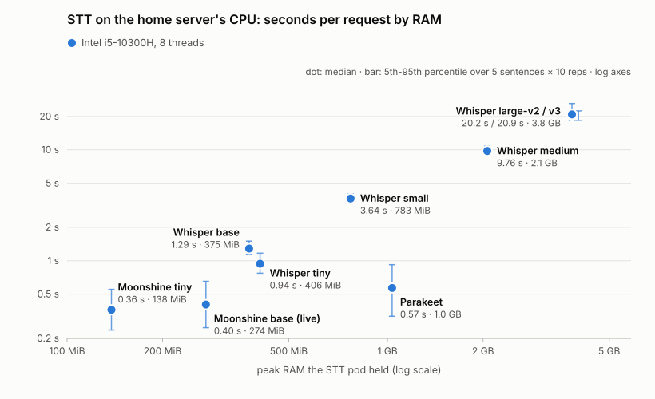
</picture>

<picture>
  <source media="(prefers-color-scheme: dark)" srcset="assets/charts/stt-gpu-speed-vs-vram-dark.svg">
  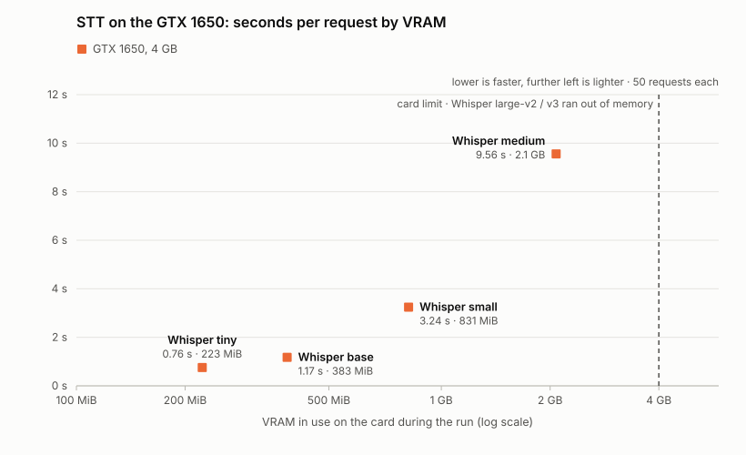
</picture>

The deployed STT is Moonshine base on CPU: 0.40 s per request in 274 MiB of RAM. Whisper is 2x to 50x slower on this hardware. On the GTX 1650 it is only slightly faster than on the CPU, and Whisper large doesn't fit the card's 4 GB at all.

### Text-to-speech

<picture>
  <source media="(prefers-color-scheme: dark)" srcset="assets/charts/tts-cpu-speed-vs-ram-dark.svg">
  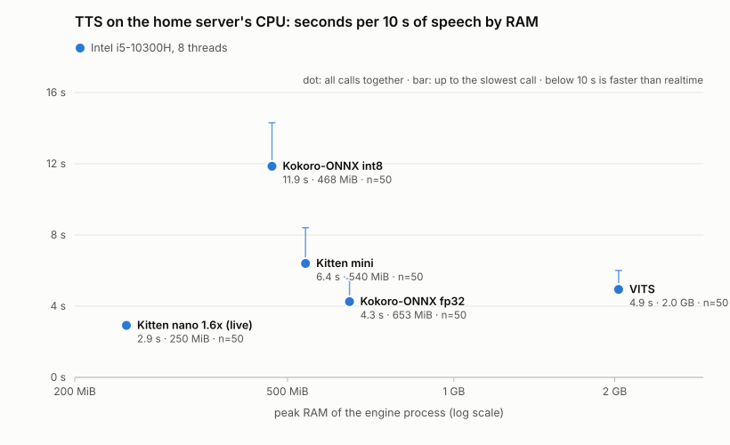
</picture>

<picture>
  <source media="(prefers-color-scheme: dark)" srcset="assets/charts/tts-gpu-speed-vs-vram-dark.svg">
  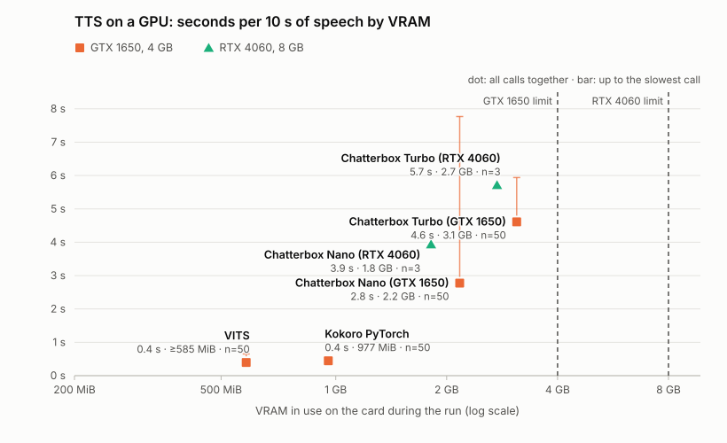
</picture>

Rina speaks with Kokoro on the GTX 1650 whenever the LLM doesn't need the card: 22x realtime in under 1 GB of VRAM. When the 1650 runs the standby LLM she falls back to KittenTTS nano on CPU at 1.6x speech speed: 3.4x realtime in 250 MiB of RAM. VITS on the 1650 is about as fast as Kokoro. Chatterbox, the voice-cloning engine, is slower than both and needs 2-3 GB of VRAM; on the CPU, VITS manages only 2x realtime in 2 GB of RAM.

### Language models

Each model ran on llama.cpp (Q4_K_M) with the same settings as the live server on its card: an 8 GB RTX 4060 with a 40K-token context, and a 4 GB GTX 1650 with a 4K-token context. Every request carried the agent's real 20 tool definitions. Speed is the median over 50 replies (5 fixed sentences, 10 times each), with thinking off. Tool calls are 13 fixed requests, 11 of which need a specific tool and 2 of which must not call any.

<picture>
  <source media="(prefers-color-scheme: dark)" srcset="assets/charts/llm-reply-vs-vram-dark.svg">
  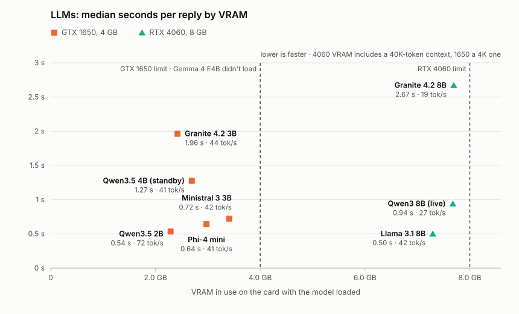
</picture>

| Model | GPU | First token | Generation | Whole reply | Tool calls | Load | VRAM |
|---|---|---|---|---|---|---|---|
| **Qwen3 8B** (live) | RTX 4060 | 0.09 s | 28 tok/s | 1.11 s | 12/13 | 10 s | 7.7 GB |
| Llama 3.1 8B | RTX 4060 | 0.24 s | 42 tok/s | 0.65 s | 11/13 | 10 s | 7.3 GB |
| Granite 4.2 8B | RTX 4060 | 0.54 s | 19 tok/s | 2.39 s | 12/13 | 17 s | 7.7 GB |
| **Qwen3.5 4B** (standby) | GTX 1650 | 0.37 s | 40 tok/s | 1.23 s | 10/13 | 87 s | 2.7 GB |
| Qwen3.5 2B | GTX 1650 | 0.13 s | 72 tok/s | 0.49 s | 8/13 | 76 s | 2.3 GB |
| Ministral 3 3B | GTX 1650 | 0.25 s | 42 tok/s | 0.72 s | 12/13 | 56 s | 3.4 GB |
| Granite 4.2 3B | GTX 1650 | 0.28 s | 44 tok/s | 1.68 s | 10/13 | 58 s | 2.4 GB |
| Phi-4 mini | GTX 1650 | 0.11 s | 41 tok/s | 0.58 s | 2/13 | 79 s | 3.0 GB |

With thinking on, both Qwen models passed all 13 tool calls, but the first spoken word came after 5.8 s on the 4060 and 2.4 s on the 1650, too slow for a voice reply. Ministral 3 3B is the strongest standby candidate: the same tool score as the 8B models at 0.72 s per reply, though at 3.4 GB it leaves the 1650 almost no room for anything else. VRAM on the 4060 is mostly the 40K-token KV cache, not the weights. Load times on the 1650 include starting the container from the home server's hard disk.

## Hardware and setup

- **Voice device:** M5StickS3 (ESP32-S3)
- **Relay:** Android phone with BLE and a connection to the backend
- **Compute:** laptop with an RTX 4060; home server with a GTX 1650
- **Backend:** k3s, Moonshine, Qwen on llama.cpp, Kokoro and KittenTTS

```bash
git clone https://github.com/adixg/voice-assistant.git
cd voice-assistant
```

This is a hardware-specific, self-managed deployment rather than a one-command install.
