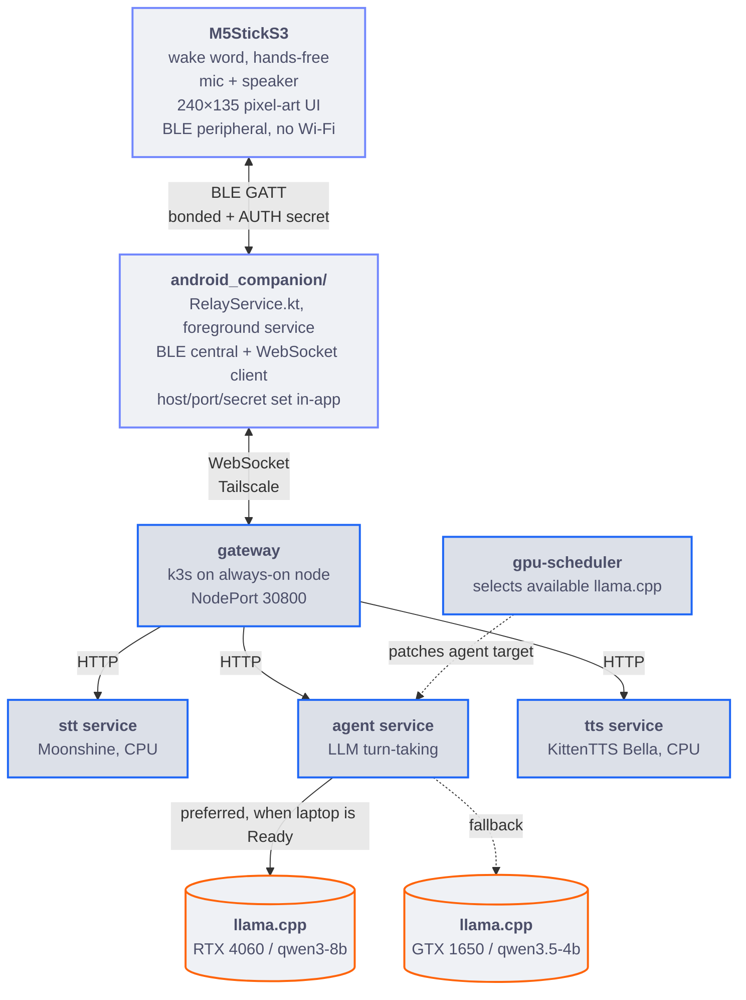
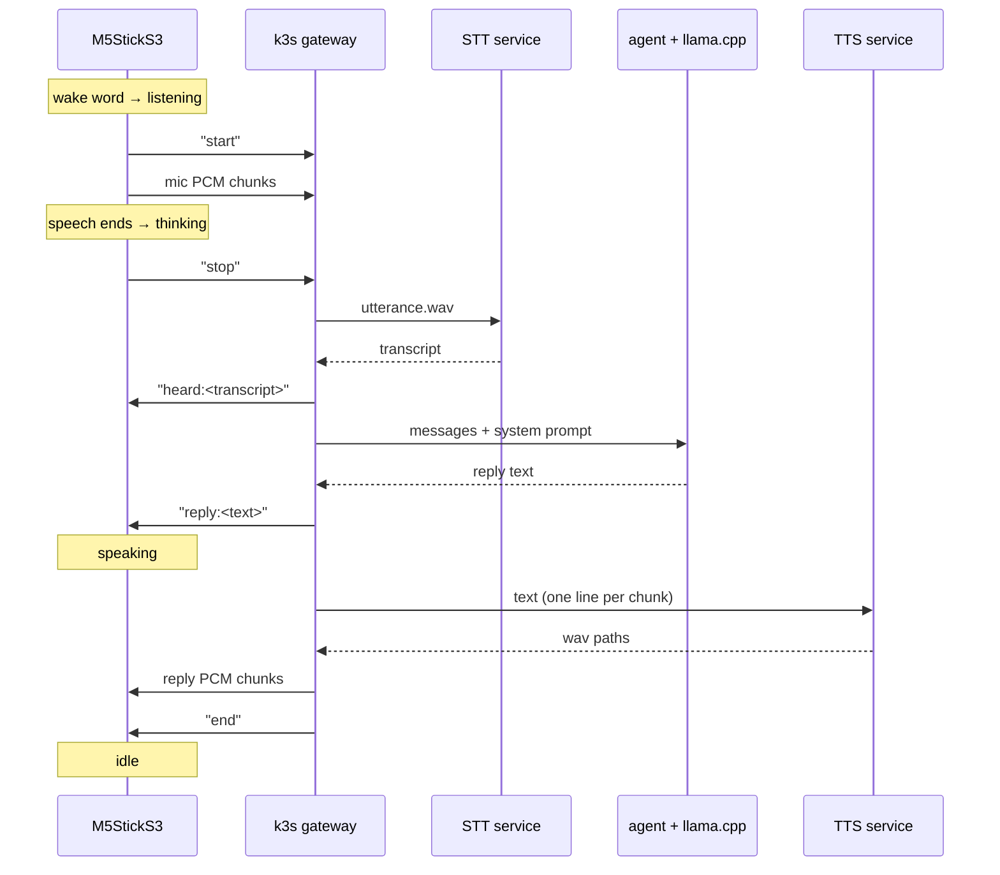
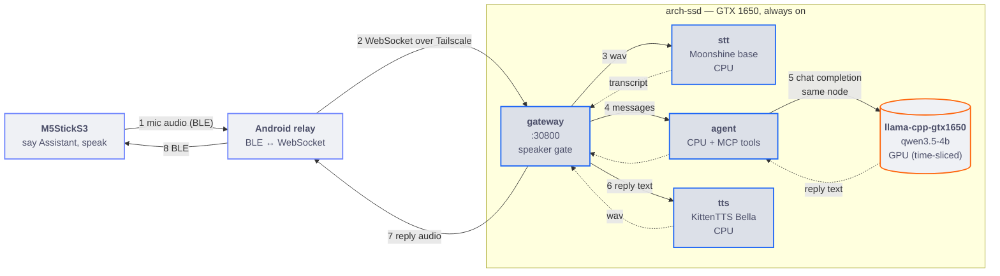
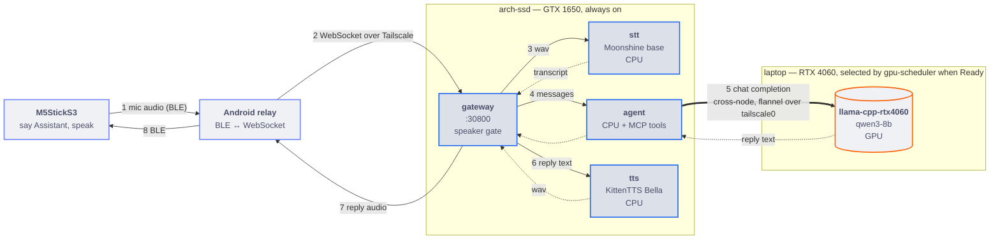
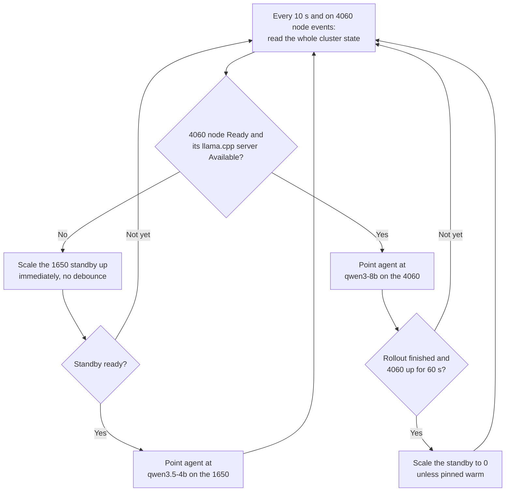
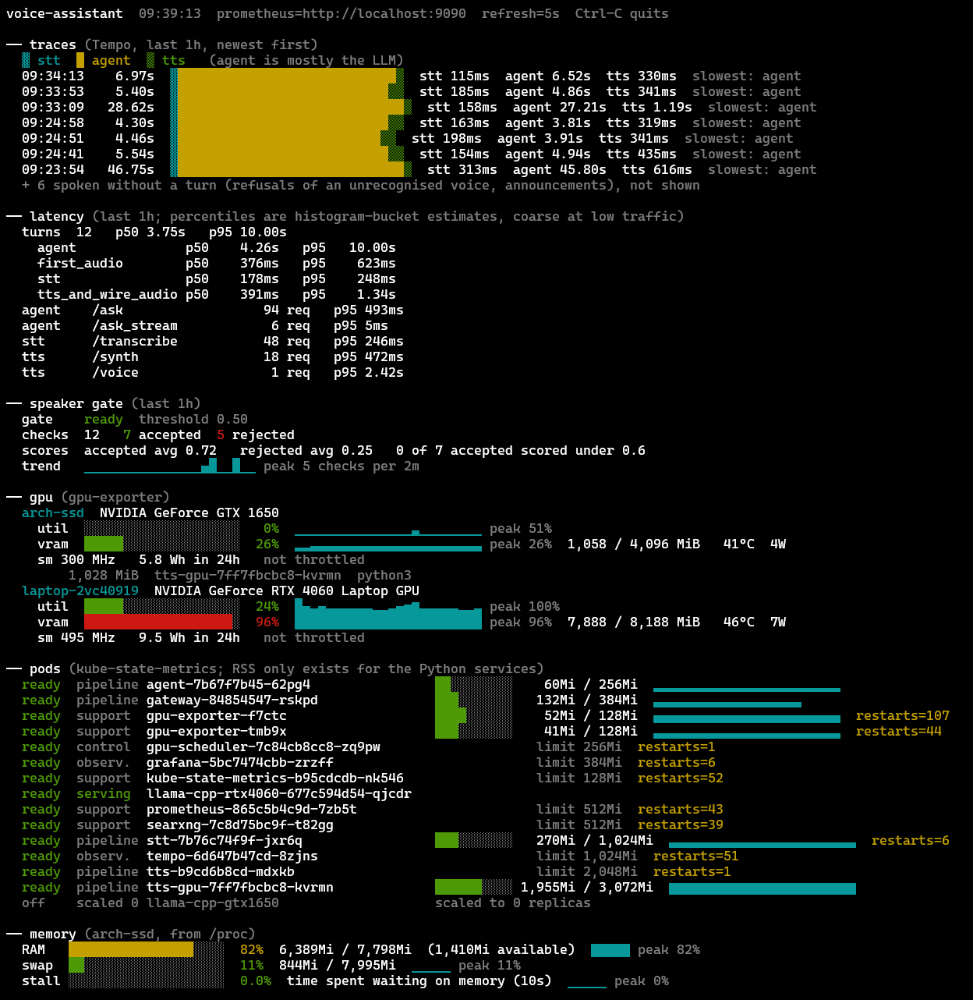
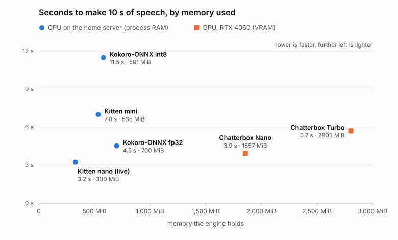

# AI Companion

**A self-hosted, hands-free voice assistant: say "Assistant" to a tiny ESP32-S3 device and a small Kubernetes cluster on consumer GPUs answers out loud.**

I built AI Companion to turn an M5StickS3 into a voice interface for locally hosted speech and language models. The Stick listens for its wake word on-device, then sends your speech over **Bluetooth Low Energy (BLE)** to an Android relay and on to a **k3s** backend running speech-to-text, LLM inference, tools, and text-to-speech. A custom controller handles GPU availability and inference failover between my laptop and home server.

<table>
  <tr>
    <th>Rina</th>
    <th>Clock</th>
    <th>Pomodoro</th>
  </tr>
  <tr>
    <td></td>
    <td></td>
    <td></td>
  </tr>
</table>

## Features

- **Wake word:** say "Assistant" and the Stick starts listening, using a microWakeWord model trained locally and running on the device (2.8 ms per 30 ms of audio).
- **Hands-free conversation:** an on-device endpointer detects when you start and stop speaking and sends only the speech. No button needed; holding BtnB starts the same mode, and hold-to-talk on BtnA remains as a fallback.
- **Local speech and language:** Moonshine STT and KittenTTS on CPU, Qwen on llama.cpp, with replies spoken a sentence at a time so audio starts before the whole reply is ready.
- **Agent tools over MCP:** web search, notes, reminders, voice switching ("switch to Kokoro Bella"), Stick volume and brightness, and `ask_claude` for questions the local model can't answer well.
- **Speaks first:** reminders and encouragement arrive unprompted, with no button press.
- **Speaker verification:** ECAPA-TDNN matching against an enrolled voiceprint.
- **Embedded interface:** animated pixel-art face, clock, and pomodoro timer on a 240×135 display.
- **Resilience:** BLE reconnection, OTA firmware updates over BLE with automatic rollback, and GPU inference failover.
- **Observability:** OpenTelemetry traces, Prometheus metrics, Grafana dashboards, Tempo, a custom NVML GPU exporter, and a terminal dashboard (`tools/obs_tui.py`).
- **Validation:** CI runs the test suite, validates the Kubernetes manifests, and builds the firmware, the Android app, and the service images.

Still in progress: raise-to-talk, haptic feedback, voice isolation, and a long-duration BLE soak test.

## Architecture



One turn, from wake word to reply. The Android relay translates these messages 1:1 to and from BLE frames.



<details>
<summary><b>How a turn runs in each GPU mode</b></summary>

The loop is the same in both modes; the only thing that changes is which llama.cpp server the `agent` calls.

**Laptop offline: GTX 1650 only (fallback).**



**Laptop Ready: RTX 4060 online (preferred).**



</details>

## Custom Kubernetes controller

Stock Kubernetes decides where a pod runs, not which of two backends a live service should call. `gpu-scheduler` fills that gap: it prefers the laptop's **RTX 4060** for inference and falls back to the home server's **GTX 1650** when the laptop goes away, so `agent` never targets a server that isn't there.



**Tradeoff:** this is *availability-based failover*, not per-request load balancing. A cold fallback takes about 61 s to load its model, on top of the time k3s takes to notice the node is gone, unless `tools/standby.sh warm` keeps it running at the cost of its RAM and VRAM.

<details>
<summary><b>Failover details</b></summary>

Switching modes is automatic. `gpu-scheduler` re-evaluates every 10 seconds and
on every 4060 node event, from the whole picture rather than one transition: the
4060 counts as up only when its node is `Ready` **and** `llama-cpp-rtx4060` is
serving. Then:

- **4060 up**: it patches `agent` to `LLM_HOST=http://llama-cpp-rtx4060:8080/v1`,
  `LLM_MODEL=qwen3-8b`, and once that rollout has finished **and the 4060 has been
  up for 60 seconds** it scales `llama-cpp-gtx1650` to zero, freeing about 1 GiB
  of RAM and 3.4 GiB of VRAM on the home server. The 60 s debounce keeps a
  laptop that sleeps and wakes from making the 1650 reload its model every time.
- **4060 lost** (`NotReady`, deleted, or its server down): it scales the 1650
  standby back up first, and only points `agent` at
  `http://llama-cpp-gtx1650:8080/v1`, `qwen3.5-4b` once the standby reports
  ready, so `agent` never targets a server that isn't there. From zero that is a
  model load (about 50 s, 61 s measured end to end) on top of the time k3s takes to
  notice the node is gone; a turn during that window fails and should be retried.
- **Pinned warm**: `tools/standby.sh warm` keeps the standby running for an
  instant failover at the cost of its RAM/VRAM; `auto` hands it back.

Each patch to `agent` rolls its pod, so a turn in flight during a switch can fail.
Nothing the Stick or phone talks to moves in either case.

</details>

## Observability

Every stage of a voice turn is measured, and the monitoring stack stays up when the laptop goes away because it runs on the always-on node.

- **Prometheus** scrapes the gateway, STT, agent, TTS, kube-state-metrics, and the GPU exporter every 15 seconds, including per-stage turn latency.
- **Grafana** provisions a service-performance dashboard: target health, request and error rate, HTTP and gateway latency, pod readiness and restarts, GPU and VRAM use, and traces.
- **OpenTelemetry and Tempo** trace a turn across services, breaking it into STT, LLM, and TTS.
- **A custom NVML GPU exporter** (`services/gpu_exporter`) replaced NVIDIA's DCGM Exporter, going from about 405 MiB to 37 MiB while adding clocks, throttle reasons, energy, XID errors, and VRAM per pod.
- **A terminal dashboard** (`tools/obs_tui.py`, standard library only) shows host memory, GPUs, pods, latency, and recent turns without a browser.

<!-- Add assets/charts/obs-tui.png and assets/charts/distributed-trace.png, then uncomment:


-->

## Benchmarks

I compared STT and TTS models on latency and memory to choose what's practical for my hardware. Every number traces back to a file in [`benchmarks/runs/`](benchmarks/runs/).

### Speech-to-text

<!-- Add assets/charts/stt-benchmarks.svg, then uncomment:

-->

### Text-to-speech

<picture>
  <source media="(prefers-color-scheme: dark)" srcset="assets/charts/tts-speed-vs-memory-dark.svg">
  
</picture>

The deployed backend is KittenTTS nano on CPU: 3.1x realtime at about 560 MiB on the home server.

## Hardware and setup

- **Voice device:** M5StickS3 (ESP32-S3)
- **Relay:** Android phone with BLE and a connection to the backend
- **Compute:** laptop with an RTX 4060; home server with a GTX 1650
- **Backend:** k3s, Moonshine, Qwen on llama.cpp, KittenTTS

```bash
git clone https://github.com/adixg/voice-assistant.git
cd voice-assistant
```

This is a hardware-specific, self-managed deployment rather than a one-command install. Start with [`docs/setup.md`](docs/setup.md). Do not expose the gateway directly to the public internet without authentication.

## More details

- [Setup and using the Stick](docs/setup.md)
- [Development: layout, tests, CI, swapping backends, debugging](docs/development.md)
- [Deployment architecture](docs/deployment-architecture.md)
- [Voice pipeline](docs/voice-pipeline.md), [BLE migration](docs/ble-migration.md), [firmware notes](docs/firmware-notes.md), [hardware budget](docs/hardware-budget.md)
- **Part 1:** custom Kubernetes controller, distributed tracing, and model benchmarking *(blog forthcoming)*
- **Part 2:** ESP32 communication, streaming audio, and internet-enabled agent tools *(forthcoming)*

> **Note:** model inference runs locally, but web search and `ask_claude` need internet access.
